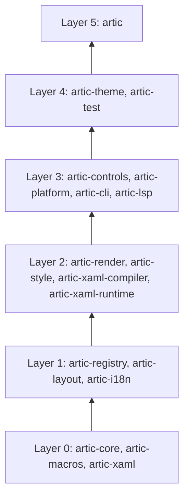

# artic

A cross-platform UI framework for Rust. Views are written in XAML, all logic is Rust, and one GPU renderer draws the same pixels on Windows, macOS, Linux, iOS and Android.

> **Status:** early development. The workspace is set up but nothing is usable yet. The v1 plan is tracked in the [milestones](https://github.com/wolfware-labs/artic/milestones).

## Goals

- Views use XAML syntax (a defined subset of MS-XAML 2012) with CSS-like style selectors.
- The design follows Rust, not a class hierarchy: controls are structs composed from shared state, nodes live in an arena and are referenced by id, and values convert through `FromStr` and `TryFrom`.
- Bindings are typed and checked at compile time. There is no runtime reflection.
- Release builds compile XAML to plain Rust in `build.rs`, so there is no parsing at startup. With `--features hot-reload`, views reload from disk while the app runs.
- Signals propagate every change. View-models and `{Binding}` are built on them.
- `vello` on `wgpu` draws every platform. Layouts adapt to screen size and input mode, not to the OS.
- Every control exposes an `accesskit` node.

## A view

```xml
<UserControl xmlns="https://artic.rs/ui"
             xmlns:x="https://artic.rs/markup"
             x:Class="app::views::LoginView"
             x:DataType="app::vm::LoginVm">
  <StackPanel Spacing="8" Margin="16">
    <TextBox Text="{Binding Email, Mode=TwoWay}" Watermark="Email"/>
    <Button Classes="primary" Content="Sign in" Command="{Binding SignIn}"/>
  </StackPanel>
</UserControl>
```

```rust
#[derive(ViewModel, Default)]
pub struct LoginVm {
    email: Signal<String>,
}

impl LoginVm {
    #[command]
    async fn sign_in(&self, cx: &VmCx) -> Result<(), AuthError> {
        // ...
    }
}
```

This is the planned API. None of it is implemented yet.

## Project structure

```
.
├── Cargo.toml            Workspace manifest, shared package metadata and lints
├── rust-toolchain.toml   Pinned Rust toolchain
├── crates/               One directory per crate (see below)
└── docs/
    ├── architecture.md   Crate layers and the dependency graph
    └── spec/
        └── technical_spec.md
```

## Crates and layers

The workspace is layered. A crate depends only on crates in lower layers, so the core can be built and tested without the controls, and the controls without a platform host.

| Layer | Crate | Responsibility |
| --- | --- | --- |
| 0 | `artic-core` | Signals, effects, `Property<T>`, the node arena and trees, the UI dispatcher |
| 0 | `artic-macros` | `#[derive(XamlType)]`, `#[derive(ViewModel)]`, `#[xaml_class]` and related macros |
| 0 | `artic-xaml` | XAML parser, markup extension grammar and spanned diagnostics |
| 1 | `artic-registry` | Type metadata that maps XAML names to Rust types and properties |
| 1 | `artic-layout` | Measure and arrange protocol, geometry types, panels |
| 1 | `artic-i18n` | Optional localizer backed by Fluent `.ftl` files |
| 2 | `artic-render` | `Renderer` trait, retained scene, `vello` backend |
| 2 | `artic-style` | Selectors, styles, setters, resource dictionaries |
| 2 | `artic-xaml-compiler` | Build-time compiler from XAML to Rust |
| 2 | `artic-xaml-runtime` | Runtime loader for hot reload and `runtime-xaml` |
| 3 | `artic-controls` | Templated controls such as `Button`, `TextBox` and `ListBox` |
| 3 | `artic-platform` | Windows, input, lifecycle, OS services and the `accesskit` adapter |
| 3 | `artic-cli` | The `cargo artic` command |
| 3 | `artic-lsp` | Language server for `.xaml` files |
| 4 | `artic-theme` | Default token-based theme and control templates |
| 4 | `artic-test` | Headless host and test helpers |
| 5 | `artic` | Facade crate that apps depend on |



[docs/architecture.md](docs/architecture.md) has the exact dependency edges and the rules behind them.

### How a view becomes pixels

1. `artic-xaml` parses a `.xaml` file into an infoset.
2. In a normal build, `artic-xaml-compiler` turns the infoset into Rust from `build.rs`. With hot reload, `artic-xaml-runtime` builds the same tree at runtime. A conformance test keeps the two paths identical.
3. `artic-core` holds the tree and the signals. Bindings and styles write to properties through one invalidation path.
4. Each frame runs only the dirty stages: style, layout (`artic-layout`), scene building and rendering (`artic-render`), then the accessibility update (`artic-platform`).

## Platforms

| Platform | Minimum |
| --- | --- |
| Windows | 10 |
| macOS | 12 |
| Linux | X11 and Wayland |
| iOS | 15 |
| Android | 8 (API 26) with Vulkan 1.1 |

Web is not a v1 target. App-facing APIs are kept target-neutral so it can be added later without app changes.

## Building

The toolchain is pinned in `rust-toolchain.toml`, and `rustup` installs it on first use.

```sh
cargo build --workspace
cargo test --workspace
cargo clippy --workspace --all-targets
```

## Documentation

- [Technical spec](docs/spec/technical_spec.md): the full v1 design.
- [Architecture](docs/architecture.md): crate layers and dependency rules.

## License

Licensed under either of the Apache License, Version 2.0 or the MIT license, at your option.
