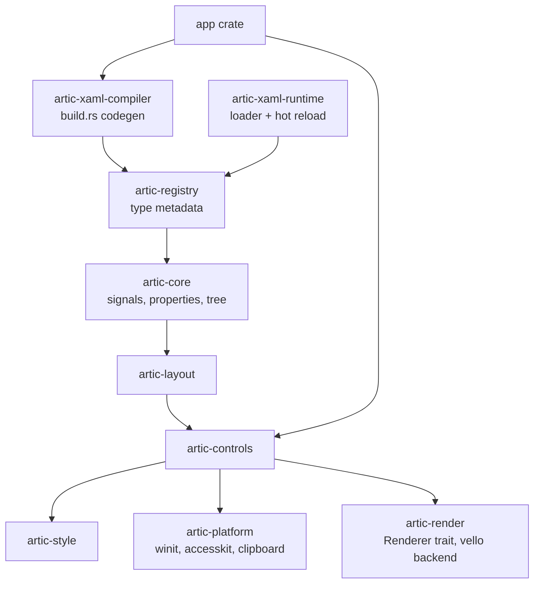
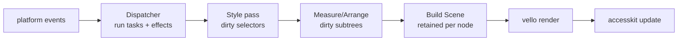
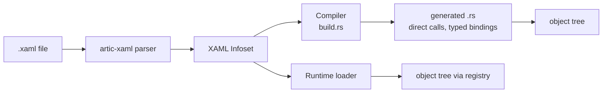

# artic — Technical Specification

Sep 23, 2026 · @Mariano

## 1. Overview and locked decisions

A cross-platform desktop and mobile UI framework where views are written in XAML (a defined subset of [MS-XAML 2012](https://learn.microsoft.com/en-us/openspecs/microsoft_domain_specific_languages/MS-MSDLLP/69a08c4f-e943-4729-be0d-1b33d4ad967e) with an Avalonia-style vocabulary) and all logic is Rust. **The framework is named artic (artic.rs); crates are prefixed artic-**.

### Goals

- XAML that a WPF/Avalonia developer can read and mostly write without retraining.
- Rust-native, not .NET-on-Rust: composition and traits instead of class hierarchies, generics and concrete enums instead of \`dyn Any\`, std traits (\`FromStr\`, \`TryFrom\`, \`Result\`) instead of framework-specific converter and exception APIs, arena ids instead of shared mutable references. String-keyed lookup exists only where XAML markup needs it and only in the hot-reload loader.
- Same pixels on Windows, macOS, Linux, iOS, and Android via one GPU renderer; layouts adapt to screen class and input mode, not to OS.
- Compiled XAML for release (type-checked, zero parse cost at startup) and interpreted XAML in development (hot reload).
- Fine-grained reactivity underneath; MVVM ergonomics (observable view-models, `{Binding}`) on top.

### Non-goals for v1

- Web/WASM. The platform layer is abstracted so it can be added, but no v1 work targets it.
- Native-looking widgets. Controls are templated and drawn by the framework; one default theme ships.
- Full MS-XAML conformance. Unsupported constructs are listed in §4 and produce compile errors, not silent behavior.
- DataGrid, TreeView, Menu bar controls, dialogs (v2). A Rust-only view API (views built in code without XAML) is v2, but v1 must not preclude it: the control structs and \`Property\<T>\` fields are the API, and the XAML compiler emits calls to it.

### Locked decisions

| Area | Decision |
| --- | --- |
| XAML dialect | MS-XAML 2012 syntax; Avalonia-style vocabulary and CSS-like selectors |
| Rendering | Own GPU renderer: `wgpu` + `vello` behind a `Renderer` trait; `skia-safe` as an optional second backend |
| Windowing | `winit` on all five targets behind a `PlatformHost` trait; mobile lifecycle (suspend/resume, surface loss, safe areas) is part of that trait |
| Platforms v1 | Windows 10+, macOS 12+, Linux (X11 + Wayland), iOS 15+, Android 8+ (API 26); one app crate, one binary per target |
| XAML loading | Both: build-time compiler (`build.rs`) and runtime loader, both driven by one generated type registry |
| Reactivity | Signals (fine-grained, synchronous, glitch-free) as the primitive; `#[derive(ViewModel)]` and `{Binding}` on top |
| Styling | Avalonia-style selectors (`Button.primary:pointerover > TextBlock`) with `Setter`s; no WPF triggers |
| Control set v1 | Panels, TextBlock, TextBox, Button, ToggleButton, CheckBox, RadioButton, Slider, ScrollViewer, ItemsControl, ListBox, ComboBox, TabControl, Border, Image, ContentControl |
| Events | Both `x:Class` code-behind handlers and MVVM commands/bindings |
| Async | Runtime-agnostic: framework owns a single-threaded UI executor; `spawn_blocking`/background work goes to whatever the app chooses |
| Accessibility | `accesskit` from day one; every control exposes a node |
| Minimum Rust | Stable, edition 2024 |

## 2. Architecture and crate layout

The framework is a Cargo workspace of layered crates; each layer depends only on the ones below it, and the XAML pipeline sits beside the runtime, not inside it.



Arrows point from dependent to dependency. The app crate depends on the compiler only as a build-dependency.

| Crate | Responsibility | Key public types |
| --- | --- | --- |
| `artic-core` | Signals, effects, `Property<T>`, styled-property metadata, visual/logical tree, `Object` trait, resources, dispatcher | `Signal`, `Effect`, `Property`, `Node`, `TreeArena`, `Dispatcher` |
| `artic-registry` | Generated type descriptors used by both XAML paths: type name → constructor, property name → setter/getter/type converter, content property, attached properties, events | `TypeInfo`, `PropertyInfo`, `TypeConverter`, `Registry` |
| `artic-macros` | `#[derive(XamlType)]`, `#[derive(ViewModel)]`, `#[xaml_class]`, `xaml!` (inline) | proc macros |
| `artic-xaml` | Parser: XML → XAML Infoset (MS-XAML §5), markup-extension grammar, diagnostics with spans | `XamlDocument`, `XamlNode`, `MarkupExtensionAst`, `Diagnostic` |
| `artic-xaml-compiler` | Infoset → Rust source (`build.rs` API and `cargo artic` CLI) | `compile_dir()`, `CompileOptions` |
| `artic-xaml-runtime` | Infoset → live object tree using the registry; file watcher and hot-swap | `XamlLoader`, `HotReload` |
| `artic-layout` | Measure/arrange protocol, panels, invalidation | `Layoutable`, `Size`, `Rect`, `Thickness` |
| `artic-controls` | Templated controls, primitives, default `ControlTemplate`s | `Button`, `TextBox`, `ItemsControl`, … |
| `artic-style` | Selector parser and matcher, `Style`, `Setter`, pseudo-classes, resource dictionaries, theme switching | `Selector`, `Style`, `ResourceDictionary` |
| `artic-render` | `Renderer` trait, scene graph (display list), `vello` backend; text via `parley` | `Renderer`, `Scene`, `DrawingContext` |
| `artic-platform` | Window creation, event loop, DPI, clipboard, `accesskit` adapter, native menus and dialogs via `muda`/`rfd` | `Window`, `AppBuilder`, `PlatformEvent` |
| `artic` | Facade re-exporting the public API with feature flags (`hot-reload`, `skia`) | `App`, `prelude` |

### Object model in one paragraph

Every UI element is a Rust struct stored in a generational arena (`TreeArena`) and referenced by a `NodeId`; there is no `Rc<RefCell<>>` in the tree. Element structs implement the `Object` trait (registry lookup, property bag access) and `Element` (layout, render, input). Properties are `Property<T>` fields (§6) whose values are signals, so a binding, a style setter, and a direct set all write through the same path and invalidate the same dependents.

### Frame pipeline



Each stage runs only on nodes marked dirty by the previous one; a frame with no dirty nodes is skipped and the loop waits on the OS event queue.

## 3. Type system and registry

XAML needs to name types and properties by string; Rust does not. The registry exists only to serve the markup side, is generated entirely by derive macros, and is consumed at build time by the compiler, where every lookup turns into a direct, typed Rust call. The runtime loader (hot reload) is the only consumer that keeps string keys alive at runtime.

### Declaring a XAML type

```rust
#[derive(XamlType, Default)]
#[xaml(namespace = "https://artic.rs/ui", content = child)]
pub struct Border {
    pub base: ElementBase,                       // composition, not inheritance
    #[xaml] pub child: Property<Option<NodeId>>,
    #[xaml(default = Thickness::ZERO)] pub padding: Property<Thickness>,
    #[xaml] pub background: Property<Option<Brush>>,
    #[xaml] pub corner_radius: Property<CornerRadius>,
    #[xaml] pub pointer_pressed: Event<PointerEvent>,
}
```

The derive emits a `TypeInfo` const and registers it with `linkme` (distributed slice) so the registry is assembled at link time. Field types decide everything: a `Property<T>` is a settable XAML property if `T: FromStr` or `T: XamlType`; an `Event<A>` is a XAML event; a field of a type implementing `XamlCollection` accepts child elements.

### What the registry records

| Item | Fields | Consumer |
| --- | --- | --- |
| `TypeInfo` | XAML name, namespace, Rust path, `new: fn(&mut Arena) -> NodeId`, content field, `is_collection`, `is_markup_extension` | compiler, loader |
| `PropertyInfo` | name, Rust field path, value type path, `parse: fn(&str) -> Result<Value, ParseError>` (from `FromStr`), `set: fn(&mut Arena, NodeId, Value)`, `affects: Layout \| Render`, `inherits` | compiler emits `node.field.set(v)` directly; loader calls `set` |
| `AttachedPropertyInfo` | owner, name, target constraint (`Grid.Row` only under `Grid`) | both |
| `EventInfo` | name, args type path, `subscribe: fn(&mut Arena, NodeId, HandlerId)` | both |
| `MarkupExtensionInfo` | name, positional/named arg schema, `expand` | both |

`Value` is a small enum (`Str`, `Num`, `Bool`, `Node(NodeId)`, `Parsed(TypeId, Box<dyn Any>)`) used only by the loader path; the compiled path never constructs one.

### Rules

1. XAML type names map 1:1 to Rust types; lookup is exact and case-sensitive (MS-XAML).
2. Value types use std traits, not a custom converter API: `FromStr` for text (`Thickness`, `Brush`, `Color`, `GridLength`, `Duration`), `TryFrom` for typed conversions; `#[derive(XamlEnum)]` generates case-insensitive `FromStr` for enums.
3. Property defaults live in `PropertyInfo` and in `Property::<T>::default()`, so a removed style setter reverts correctly.
4. `inherits` marks properties (`FontSize`, `Foreground`, `IsEnabled`) that flow down the logical tree when unset.
5. Adding a type from any crate needs only the derive; no registration call.
6. Nothing in the registry is required for a Rust-only view API (v2): the same structs and `Property<T>` fields are the API; XAML is one front end to them.

### Namespaces

- `https://artic.rs/ui` — default vocabulary (`xmlns="…"`).
- `http://schemas.microsoft.com/winfx/2006/xaml` — the `x:` language namespace, as in MS-XAML, so editors and existing tooling recognize the file.
- `using:my_crate::views` — maps a Rust module path to a prefix; resolved through the registry's recorded Rust paths.

### Open question

- [ ] Should the registry also carry doc comments and default-value text for an editor/LSP (larger binary, better tooling)? Proposed: yes, behind a `registry-docs` feature.

## 4. XAML language: supported subset of MS-XAML

The parser implements MS-XAML 2012 §5 (XML → XAML Infoset) for the constructs below and rejects everything else with a spanned error. The infoset is the contract between the parser and both back ends.

### Supported

| Construct | Syntax | Notes |
| --- | --- | --- |
| Object element | `<Button/>` | Type from registry via namespace + local name |
| Attribute property | `Width="100"` | Converted with the property's `TypeConverter` |
| Property element | `<Button.Content>…</Button.Content>` | Any object as value |
| Content property | `<Button>Click</Button>` | From `#[xaml(content)]` |
| Collection content | `<StackPanel><A/><B/></StackPanel>` | Property type implements `XamlCollection` |
| Attached property | `Grid.Row="1"`, `<Grid.Row>1</Grid.Row>` | Owner type must declare it; target constraint checked |
| Type-converted text | `Margin="4,8"` | Whitespace/comma grammar per converter |
| Markup extension | `{Binding Path=Name, Mode=TwoWay}` | Grammar from MS-XAML §5.3 incl. escapes `{}` and nesting |
| `x:Name` | `x:Name="submit"` | Generates a typed field in code-behind (§9) |
| `x:Key` | on resource children | Required in `ResourceDictionary` unless `x:Type`-keyed styles |
| `x:Class` | root only | Binds to `#[xaml_class]` struct |
| `x:Type` | `{x:Type Button}` | Yields a `TypeInfo` reference |
| `x:Static` | `{x:Static local::CONSTANTS::MAX}` | Rust path to a `const`/`static`; compile-time only in v1 |
| `x:Null` | `{x:Null}` |  |
| `x:Uid`, `x:FieldModifier` |  | Accepted, no v1 semantics beyond `pub`/`pub(crate)` on generated fields |
| Primitives | `<x:String>`, `<x:Int32>`, `<x:Double>`, `<x:Boolean>` | XAML 2009 primitives |
| `x:DataType` | on `DataTemplate` and root | Enables compiled bindings (§6) |
| XML comments, CDATA, `xml:space="preserve"` |  | Per MS-XAML whitespace rules |

### Not supported (compile error, with the reason)

- `x:Code`, `x:Subclass`, `x:Shared`, `x:Arguments`, `x:FactoryMethod`, `x:TypeArguments` (no generics from XAML in v1).
- `x:Reference` (use `ElementName` binding instead).
- WPF `Trigger`, `DataTrigger`, `EventTrigger` (selectors + pseudo-classes replace them).
- `clr-namespace:` prefixes (use `using:`).
- Loose-XAML loading of arbitrary Rust types not marked `XamlType`.

### Infoset shape

```rust
pub enum XamlNode {
    Object { ty: TypeRef, members: Vec<Member>, span: Span },
    Value  { text: String, span: Span },            // untyped text, converted later
    MarkupExtension { ty: TypeRef, positional: Vec<XamlNode>, named: Vec<(String, XamlNode)>, span: Span },
}
pub struct Member { key: MemberKey, value: Vec<XamlNode> }
pub enum MemberKey { Property(String), Attached { owner: TypeRef, name: String }, Directive(Directive), Content, Items }
```

Type references stay unresolved (`TypeRef { prefix, name }`) in the infoset; resolution against the registry is the first step of each back end, so parser tests need no registry.

### Whitespace

MS-XAML default: leading/trailing whitespace in text content is trimmed, internal runs collapse to one space, and whitespace-only text between object elements is dropped. `xml:space="preserve"` and `#[xaml(whitespace = "significant")]` on a type (e.g. `TextBlock` inline collection) turn this off.

### Example view

```xml
<UserControl xmlns="https://artic.rs/ui"
             xmlns:x="http://schemas.microsoft.com/winfx/2006/xaml"
             x:Class="app::views::LoginView"
             x:DataType="app::vm::LoginVm">
  <UserControl.Resources>
    <SolidColorBrush x:Key="Accent" Color="#3B82F6"/>
  </UserControl.Resources>
  <StackPanel Spacing="8" Margin="16">
    <TextBox x:Name="email" Text="{Binding Email, Mode=TwoWay}" Watermark="Email"/>
    <Button Classes="primary" Content="Sign in"
            Command="{Binding SignIn}" Click="on_click"/>
  </StackPanel>
</UserControl>
```

## 5. XAML pipeline: compiler, runtime loader, hot reload

One parser, one infoset, two back ends that must produce identical object trees; a conformance test suite (§13) loads every sample both ways and diffs the trees.



### Build-time compiler (release path)

1. `build.rs` calls `artic_xaml_compiler::compile_dir("src/views")`; every `.xaml` becomes `$OUT_DIR/views/<name>.rs`, included via `include!` by the `#[xaml_class]` macro.
2. Type and property names resolve against the registry of all dependency crates. Because the registry is link-time, the compiler runs in a build script that links `artic-controls` and the app's own control crates as build-dependencies.
3. Output is plain Rust: `let b = arena.alloc(Button::default()); b.content.set("Sign in".into()); …`. No string lookups survive to runtime.
4. Bindings with `x:DataType` compile to typed closures (`|vm: &LoginVm| vm.email.get()`); without it, to path-based reflective bindings (§6). Unknown property on a known `x:DataType` is a compile error.
5. Generated code is deterministic and gitignored; diagnostics point at the `.xaml` line/column via `#[track_caller]`-style span tables so `cargo build` errors read like `views/login.xaml:12:9: unknown property 'Foo' on Button`.

### Runtime loader (dev path)

1. `XamlLoader::load(&registry, source) -> Result<NodeId, Diagnostics>` walks the infoset, constructs each object via `TypeInfo::new`, converts values via `TypeConverter`, and sets properties via `set_any`.
2. Bindings become reflective bindings: paths resolve at bind time through the `ViewModel` trait's `get_property(&str)` (§6). Same semantics, slower.
3. Event handlers named in XAML (`Click="on_click"`) resolve through a handler table the `#[xaml_class]` macro generates (`fn __handler(name: &str) -> Option<HandlerFn>`), so code-behind still works in interpreted mode.
4. Also the path for user-supplied XAML at runtime (themes, plugins) when the `runtime-xaml` feature is on.

### Hot reload

- With `--features hot-reload`, the app watches its `views/` directory (`notify` crate). On change, the loader parses the file; on success it rebuilds only that view's subtree, re-attaches the same view-model instance and `x:Name` bindings, restores focus and scroll offsets where the named element still exists, and swaps the subtree in place. On parse/resolve failure the old subtree stays and the diagnostic is shown in an overlay.
- Reload is view-scoped, not tree-scoped: parent state (navigation, other views) is untouched.
- Rust logic changes still require a rebuild; the design does not attempt code hot-swapping.
- Styles in a reloaded `ResourceDictionary` re-run the style pass on the whole window (cheap; selectors are indexed).

### Choosing the path

| Build | Views | Bindings | Hot reload |
| --- | --- | --- | --- |
| `cargo run` (debug, default features) | compiled | typed | off |
| `cargo run --features hot-reload` | interpreted for files under watch; compiled fallback | reflective | on |
| `cargo build --release` | compiled | typed | off; `runtime-xaml` can still load external files |

### Open questions

- [ ] Should debug builds default to interpreted XAML so hot reload is on with no flag? Proposed: no — keep debug behavior identical to release unless asked, to avoid "works in dev only" bugs.
- [ ] Compiler as a `build.rs` library only, or also a `cargo artic check` subcommand for editor diagnostics? Proposed: both; the subcommand is thin.

## 6. Reactivity: signals, properties, bindings, MVVM

Signals are the only change-propagation mechanism; `Property<T>`, bindings, styles, and view-models are built on them, so there is one invalidation path. Bindings are typed end to end: `x:DataType` is required wherever `{Binding}` appears, and there is no string-path reflection in any build.

### Signal core (`artic-core::reactive`)

- `Signal<T>`: reactive cell; `get()` records a dependency when read inside an effect, `set()` marks dependents dirty. `Copy` handle into a runtime-owned arena; `!Send`, UI-thread only.
- `Memo<T>`: derived signal, recomputed lazily when a dependency changes and its value is read.
- `Effect`: closure re-run when its dependencies change. Effects run in a batch at the end of the current dispatcher task in topological order (glitch-free).
- `batch(|| …)` coalesces multiple `set`s into one propagation.
- Ownership: signals and effects belong to a `Scope`; disposing a scope (a view subtree) disposes everything created in it. No leaks when a view is unloaded, no manual unsubscribe.
- `set()` skips propagation when `T: PartialEq` and the value is unchanged.

### `Property<T>`

A `Property<T>` is a signal plus a value-precedence stack, so several sources can write the same property without fighting:

| Precedence (high → low) | Source |
| --- | --- |
| 1 | Animation |
| 2 | Local value (`Width="100"` in XAML, `.set()` in code) |
| 3 | Binding |
| 4 | Style setter (most specific matching selector wins, §8) |
| 5 | Inherited value (`inherits` properties only) |
| 6 | Default |

The effective value is a `Memo` over the stack. `affects` metadata marks the node layout- or render-dirty when the effective value changes.

### Bindings

`{Binding Path, Mode, Converter, FallbackValue, ElementName, Source, RelativeSource}` — Avalonia's surface minus `StringFormat`. Every binding compiles to a typed closure over the declared `x:DataType`:

```rust
// generated for Text="{Binding Email, Mode=TwoWay}" with x:DataType="LoginVm"
bind_two_way(&mut arena, tb, |vm: &LoginVm| vm.email, |tb| &tb.text);
```

| Mode | Behavior |
| --- | --- |
| `OneWay` (default) | effect: source signal → property |
| `TwoWay` | plus property → source on local change; default for `TextBox.Text`, `CheckBox.IsChecked`, `Slider.Value`, `ComboBox.SelectedItem` |
| `OneTime` | read once at bind |
| `OneWayToSource` | property → source only |

- Source: `DataContext` (typed as the `x:DataType`) by default; `ElementName` resolves an `x:Name` in the same scope to its concrete control type; `RelativeSource={RelativeSource TemplatedParent}` inside templates; `Source={StaticResource}` for resources.
- Wrong path, wrong type, or a `Mode=TwoWay` on a read-only field is a compile error in the compiled path.
- Converters are plain generic types: `trait Convert<From, To> { fn convert(&self, v: &From) -> To; fn convert_back(&self, v: &To) -> Option<From>; }`; referenced via `{StaticResource}` or `{x:Static}`. No `dyn Any`.
- Path grammar: `A.B.C`, indexers `Items[0]`, `.` for the context itself. No method calls.
- `DataContext` is `Property<Option<NodeId>>` pointing at a view-model node in the arena, typed through `x:DataType`; downcast happens once at bind time, never per read.

### Hot-reload bindings

The runtime loader cannot compile a closure, so `#[derive(ViewModel)]` also emits a static accessor table for the type: `path name → typed accessor` (an enum over the field's signal handle kinds). The loader looks up the path in the table for the declared `x:DataType`; a missing path is a load error shown in the overlay. Same semantics as the compiled binding, no reflection, no `Box<dyn Any>`; the table is only linked when the `hot-reload` feature is on.

### MVVM layer

```rust
#[derive(ViewModel, Default)]
pub struct LoginVm {
    email: Signal<String>,
    password: Signal<String>,
    #[memo(email, password)] can_submit: Memo<bool>,
}
impl LoginVm {
    fn can_submit(&self) -> bool { !self.email.get().is_empty() }
    #[command(enabled = can_submit)]
    async fn sign_in(&self, cx: &VmCx) -> Result<(), AuthError> { … }
}
```

- View-models are ordinary structs whose fields are `Signal<T>`/`Memo<T>`; no `#[observable]` wrapper, no `INotifyPropertyChanged` analogue. The derive only registers the type, generates the hot-reload table, and wires `#[memo]` and `#[command]`.
- `#[command]` turns a method (sync or `async`) into a `Command` value the view can bind: `execute()` spawns it on the UI executor; `enabled: Memo<bool>`; `running: Signal<bool>` while an async command is in flight. Parameters are typed: `fn delete(&self, id: ItemId)` binds with `CommandParameter="{Binding Id}"` and the compiler checks the type.
- Errors returned from a command surface as a `Signal<Option<E>>` on the command for the view to bind; nothing is thrown.
- `ObservableVec<T>`: signal-backed list emitting `Inserted/Removed/Moved/Reset` diffs so `ItemsControl` updates rows without rebuilding.
- View-models are UI-thread objects; background work returns results via `Dispatcher::post` (§11). `VmCx` gives access to the dispatcher and to services registered on the `App`.

### Open question

- [ ] Should signals be the *public* API for app code too (Leptos style `let count = signal(0)` in a Rust-only view)? Proposed: yes; it is the same API the view-model fields use.

## 7. Visual tree, layout, and controls

Two trees, as in WPF/Avalonia: the **logical tree** (what the XAML declared; scope for `DataContext`, resources, names) and the **visual tree** (what is measured and drawn, including template expansions). Both live in the same arena; each node stores its logical parent and visual parent separately.

### Element traits and composition

There is no control class hierarchy. A control is a struct that embeds the state it needs and implements the traits for the behavior it has; `#[derive(Element)]` delegates the shared parts to the embedded `ElementBase`.

```rust
pub trait Element: XamlObject {
    fn measure(&mut self, cx: &mut LayoutCx, available: Size) -> Size;
    fn arrange(&mut self, cx: &mut LayoutCx, final_rect: Rect);
    fn render(&self, cx: &mut RenderCx, scene: &mut SceneBuilder);
    fn hit_test(&self, cx: &HitTestCx, point: Point) -> HitTestResult { cx.bounds_test(point) }
    fn on_event(&mut self, cx: &mut EventCx, event: &Event) -> Handled { Handled::No }
    fn accessibility(&self, cx: &AccessCx) -> accesskit::Node;
}
pub trait Templated: Element { fn template(&self) -> &Property<Option<ControlTemplate>>; fn on_apply_template(&mut self, cx: &mut TemplateCx); }
pub trait HasContent: Element { fn content(&self) -> &Property<Content>; }
pub trait Selecting: Element { fn selection(&self) -> &Selection; }

#[derive(Element, XamlType, Default)]
pub struct Button {
    pub base: ElementBase,
    pub content: ContentState,       // gives HasContent via derive delegation
    pub template: TemplateState,     // gives Templated
    #[xaml] pub click: Event<ClickEvent>,
    #[xaml] pub command: Property<Option<Command>>,
}
```

- `ElementBase` holds the universal state: `Width/Height/Min*/Max*`, `Margin`, `HorizontalAlignment/VerticalAlignment`, `Visibility`, `IsEnabled`, `IsVisible`, `Opacity`, `ZIndex`, `Classes`, `Name`, `DataContext`, `Cursor`, `Focusable`, `ToolTip` (v1: text), `RenderTransform` (translate/scale/rotate).
- Reusable state structs (`ContentState`, `TemplateState`, `SelectionState`, `RangeState`) replace the WPF base classes `ContentControl`, `TemplatedControl`, `SelectingItemsControl`, `RangeBase`; the derive implements the matching trait when it sees the field.
- Style selectors match on the Rust type name; "derived type" matching (`Button` matching a `ToggleButton`) does not exist. A style meant for several controls lists them or uses a class.
- App-defined controls are the same derive on the same traits; nothing in the framework is special-cased.
- `Content` is an enum, not `Box<dyn Any>`: `Text(String)`, `Node(NodeId)`, `Data(DataRef)` (a view-model node plus a `DataTemplate` lookup).

### Layout protocol

WPF two-pass measure/arrange with these rules:

1. `measure(available)` returns the desired size, already including `Margin`. Results are cached per `available`; a node re-measures only when it or a descendant is `InvalidateMeasure`d, or `available` changes.
2. `arrange(rect)` positions children; alignment and `Margin` are applied by `ElementBase` before the element's own `arrange_override`, so control authors only place children.
3. Infinite constraints are legal (`ScrollViewer`, `StackPanel` on its axis). An element that returns an infinite desired size is a bug and panics in debug.
4. Layout runs top-down from the highest dirty node; a dirty leaf whose desired size does not change stops propagation (`LayoutCx::desired_size_changed`).
5. Units are logical pixels (`f32`); the platform layer supplies the scale factor; rounding to device pixels happens in `arrange` (`UseLayoutRounding` on by default).
6. Layout is synchronous and single-threaded; a `LayoutManager` runs it once per frame after effects.

### Panels (v1)

| Panel | Semantics |
| --- | --- |
| `StackPanel` | `Orientation`, `Spacing` |
| `DockPanel` | `Dock` attached; `LastChildFill` |
| `Grid` | `RowDefinitions`/`ColumnDefinitions` with `Auto`, `*`, fixed; `Grid.Row/Column/RowSpan/ColumnSpan`; short syntax `ColumnDefinitions="Auto,*,2*"` |
| `WrapPanel` | `Orientation`, `ItemWidth/ItemHeight` |
| `Canvas` | `Canvas.Left/Top/Right/Bottom` |
| `UniformGrid` | `Rows`, `Columns` |
| `Panel` | base; `Children` collection, `Background` |

### Control set (v1)

| Control | Composed of | Template parts (`PART_*`) | Notes |
| --- | --- | --- | --- |
| `TextBlock` | base | — | `Text`, `Inlines` (Run, Bold, Italic), wrapping, trimming |
| `Image` | base | — | `Source` (path/bytes), `Stretch` |
| `Border` | base | — | child, background, border brush/thickness, corner radius, `BoxShadow` |
| `ContentPresenter` | base + content | — | resolves `Content` to text, node, or `DataTemplate` |
| `Button` | base + content + template | `PART_ContentPresenter` | `Click`, `Command`, `CommandParameter`, `IsDefault`, `IsCancel` |
| `ToggleButton` | Button's parts + `ToggleState` | same | `IsChecked: Option<bool>` |
| `CheckBox`, `RadioButton` | as ToggleButton | same | `GroupName` on radio |
| `TextBox` | base + template + `TextEditor` | `PART_TextPresenter`, `PART_ScrollViewer` | single/multi-line, selection, IME (§12), `Watermark`, `PasswordChar`, `AcceptsReturn` |
| `Slider` | base + template + `RangeState` | `PART_Track`, `PART_Thumb` | `Minimum/Maximum/Value`, keyboard steps |
| `ScrollViewer` | base + content + template | `PART_Content`, `PART_HScrollBar`, `PART_VScrollBar` | smooth wheel scrolling, overlay scrollbars on macOS |
| `ItemsControl` | base + template + `ItemsState` | `PART_ItemsPresenter` | `Items`, `ItemTemplate`, `ItemsPanel`; consumes `ObservableVec` diffs |
| `ListBox` | ItemsControl's parts + `SelectionState` | `PART_ScrollViewer` | `SelectedItem/Index`, `SelectionMode`, virtualization |
| `ComboBox` | as ListBox + `PopupState` | `PART_Popup`, `PART_Toggle` | popup rendered in the window's overlay layer |
| `TabControl` | ItemsControl's parts + `SelectionState` | `PART_TabStrip`, `PART_Content` | `TabItem` header/content |
| `Popup` | base | — | overlay-layer primitive used by ComboBox, ToolTip |
| `UserControl` | base + content | — | root for app views |
| `Window` | base + content | — | title, size, `SizeToContent`, decorations |

Every `TemplatedControl` ships a default `ControlTemplate` in the theme dictionary (§8) and looks up `PART_*` names after the template is applied (`on_apply_template`). Missing required parts are an error in debug.

### Virtualization

`ListBox` and `ItemsControl` with `VirtualizingStackPanel` realize only items intersecting the viewport plus a buffer, recycle containers, and support variable item heights with an estimated-size scroll extent. `ObservableVec` diffs map to container insert/remove without a full reset.

### Open questions

- [ ] `Grid` short syntax only, or also the `<Grid.ColumnDefinitions>` element form? Proposed: both (the element form is what the spec allows; the string form is a type converter).
- [ ] Ship `SplitView`/`Expander` in v1 or defer? Proposed: defer.

## 8. Styling, resources, templates, themes

Styling is Avalonia's model: `Style` objects with a CSS-like `Selector` and a list of `Setter`s, collected in `Styles` on any element or in a theme; matching is indexed and incremental, so a pseudo-class change re-evaluates only styles whose selector mentions that class.

### Selector grammar (v1)

| Selector | Matches |
| --- | --- |
| `Button` | type, including derived types (`:is()` not needed) |
| `Button.primary` | element whose `Classes` contains `primary` |
| `Button#submit` | `x:Name`/`Name` = `submit` |
| `Button:pointerover`, `:pressed`, `:focus`, `:focus-visible`, `:disabled`, `:checked`, `:selected` | pseudo-classes set by the control (`PseudoClasses::set`) |
| `Button:not(.primary)` | negation |
| `StackPanel > Button` | direct child (visual tree) |
| `StackPanel Button` | descendant |
| `Button /template/ ContentPresenter` | inside the control's template (template boundary is opaque otherwise) |
| `Button[IsDefault=True]` | property equals literal (type-converted) |
| `:nth-child(2n+1)`, `:nth-last-child` | index in parent's children |
| `Button, TextBlock` | list |
| `^` / `:is(Button)` | no; deferred |

Specificity: (id, class+pseudo+attr, type), CSS rules; later styles in the same collection win ties; styles closer to the element in the tree win over theme styles.

```xml
<Style Selector="Button.primary:pointerover">
  <Setter Property="Background" Value="{DynamicResource AccentHover}"/>
</Style>
```

### Setters

- `Setter` writes at precedence 4 (§6) through the property's `set_any`; removal (selector stops matching) reverts to the next value in the stack — no need to "unset".
- `Setter Property="Template"` sets a `ControlTemplate`; `Setter Property="Theme"` (v2) is out.
- Animations: `Transitions` (`<DoubleTransition Property="Opacity" Duration="0:0:0.15"/>`) animate a property between its old and new effective value; keyframe `Animation` is v2.

### Resources

- `ResourceDictionary` on any element (`Resources` property), on `Application`, and via `MergedDictionaries` (`Source="avares://…"`-style URIs replaced by `Source="crate://my_crate/themes/dark.xaml"` resolved at build time, or a file path with the runtime loader).
- `{StaticResource Key}`: resolved once at load, walking logical parents then application then theme; missing key is a compile error in the compiled path.
- `{DynamicResource Key}`: resolved through a signal; swapping a dictionary (theme change) updates every consumer.
- Resource values are any registry type; converters apply to string values by target property type.

### Templates

| Template | Sets | Special bindings |
| --- | --- | --- |
| `ControlTemplate` | `TemplatedControl.Template`; `TargetType` required | `{TemplateBinding Prop}` = one-way to templated parent; `{Binding RelativeSource={RelativeSource TemplatedParent}}` for two-way |
| `DataTemplate` | `ContentControl.ContentTemplate`, `ItemsControl.ItemTemplate`; `x:DataType` enables compiled bindings | `DataContext` = the item |
| `ItemsPanelTemplate` | `ItemsControl.ItemsPanel` | — |
| `DataTemplates` collection | on any element; selected by `x:DataType` against the item's registered type | implicit templates |

Templates are instantiated per use from their infoset (runtime) or from a generated factory `fn` (compiled). A template instance is a new name scope; `x:Name` inside it does not collide with the view's names.

### Themes

- `artic-theme-fluent` ships light and dark dictionaries plus the default `ControlTemplate` for every v1 control; the app picks with `<Application.Styles><FluentTheme Mode="System"/></Application.Styles>`.
- `Mode="System"` follows the OS setting via `PlatformHost::color_scheme` and swaps dictionaries through `DynamicResource`.
- Mobile-specific sizing (44 px touch targets, larger fonts) is a second variant dictionary, `FluentTheme Density="Touch"`, selected automatically when the primary input is touch (§12) or forced.

### Open questions

- [ ] Style inline in code-behind (`Style::new("Button.primary").setter(…)`) as a supported builder API in v1? Proposed: yes; it is what the compiler emits anyway.
- [ ] Media-style queries (`:screen(compact)` pseudo-class from window width) for adaptive layouts across desktop and phone? Proposed: yes, as pseudo-classes on the root set by the platform layer.

## 9. Events, routing, commands, code-behind

Input becomes routed events (tunnel then bubble through the visual tree, as in WPF), and app code receives them either as `x:Class` handler methods or as `Command` bindings; both are first-class and can coexist in one view.

### Routed events

- `RoutedEvent<A>` is a static descriptor (name, routing strategy `Tunnel | Bubble | Direct`, args type). Raising one walks the visual tree from root to target (tunnel, `Preview*`) then target to root (bubble); any handler sets `args.handled = true` to stop.
- Handlers are stored per node in a small vec keyed by event id; `handled_events_too: bool` lets a handler see already-handled events.
- Core events (all `Preview*` variants exist for tunnel): `PointerPressed/Released/Moved/Entered/Exited/Wheel`, `Tapped`, `DoubleTapped`, `Holding` (touch long-press), `KeyDown/KeyUp`, `TextInput`, `GotFocus/LostFocus`, `Loaded/Unloaded`, `AttachedToVisualTree/Detached`, `SizeChanged`.
- Gesture recognition (`Tapped`, `DoubleTapped`, `Holding`, pan/pinch via `GestureRecognizer` attached collection) runs on raw pointer events in the platform layer and raises the gesture event at the hit-test target, so mouse and touch produce the same high-level events.
- Control-level events (`Button.Click`, `SelectionChanged`, `TextChanged`, `Checked`) are ordinary routed events raised by the control.

### Code-behind (`x:Class`)

```rust
#[xaml_class("views/login.xaml")]   // includes the generated file
pub struct LoginView {
    // generated: pub email: Named<TextBox>, plus every x:Name
    attempts: u32,                     // user fields
}
impl LoginView {
    fn on_click(&mut self, cx: &mut ViewCx, args: &RoutedEventArgs) {
        self.attempts += 1;
        cx.get(self.email).text.set(String::new());
    }
}
```

- The macro generates: the struct's element wrapper (a `UserControl` node owning `Self`), a `build(&mut Arena) -> NodeId` from the compiled XAML, typed `Named<T>` handles for every `x:Name`, and a handler table `name → fn` used by both paths.
- Handler signature is `fn(&mut self, &mut ViewCx, &Args)`; `ViewCx` gives arena access and the dispatcher. Handlers are `&mut self`, so no interior mutability in code-behind.
- A handler name that does not exist is a compile error in the compiled path, a load error in the runtime path.
- Code-behind and view-model are both available: `self.view_model::<LoginVm>()` returns the `DataContext` downcast.

### Commands

- `Command` is a concrete value produced by `#[command]` on a view-model method (§6): `execute(&self, param: P)`, `enabled: Memo<bool>`, `running: Signal<bool>`. No trait object; the parameter type `P` is checked at compile time against `CommandParameter`.
- `Button`, `MenuItem` (v2), and `KeyBinding` consume commands; `IsEnabled` follows `enabled` unless a local value overrides it.
- `KeyBindings`: `<UserControl.KeyBindings><KeyBinding Gesture="Ctrl+S" Command="{Binding Save}"/></UserControl.KeyBindings>`; `Cmd` on macOS maps from `Ctrl` via `PlatformModifier`.
- Handlers return `Handled::Yes | No` rather than mutating a flag on the event; routing stops on `Yes`. `HandledEventsToo` becomes `subscribe_all(…)`.

### Focus and keyboard navigation

- One focused element per window; `Focusable=true` opts in. `Tab`/`Shift+Tab` follow visual order with `TabIndex` overrides; arrow keys within `SelectingItemsControl`. `:focus-visible` is set only after keyboard navigation, so touch/mouse do not draw focus rings.
- On mobile, focusing a `TextBox` requests the soft keyboard through `PlatformHost::set_ime(…)`; `Window` content scrolls to keep the focused element above the keyboard inset (§10).

### Open question

- [ ] Async handlers (`async fn on_click`) allowed directly, spawned on the UI executor? Proposed: yes, same as async commands; the handler gets `&mut self` only until its first await, so it takes an owned `ViewHandle` instead.

## 10. Rendering, windowing, platform layer

One `Renderer` implementation (`vello` on `wgpu`) draws every platform; the platform layer's job is only to give it a surface, deliver input, and expose OS services through one `PlatformHost` trait.

### Renderer

- `Renderer` trait: `begin_frame(surface, scale) -> Frame`, `render(&Scene)`, `resize`, `create_image`, `measure_text`. Backends: `vello` (default), `skia-safe` (feature `skia`, for platforms where compute shaders are missing or for A/B testing).
- Retained `Scene`: each element owns a `SceneFragment` (a `vello::Scene`); `render()` is called only for render-dirty nodes and the root composes fragments with transforms, clips, and opacity groups. Untouched subtrees cost nothing per frame.
- Primitives: paths (fill/stroke), rounded rects, images, text runs, linear/radial gradients, box shadows (blurred rect), clip (rect, rounded rect, path), layers with opacity and blend mode `Normal` only.
- Text: `parley` for shaping and line breaking, `skrifa` for glyph outlines, system font discovery via `fontique`; glyph cache is per renderer. Emoji: `COLRv1` via `vello` where supported, bitmap fallback.
- `wgpu` backends: DX12 on Windows, Metal on macOS and iOS, Vulkan on Linux and Android (GLES 3 fallback on Android devices without Vulkan 1.1 — falls back to the `skia` backend if `vello`'s compute pipeline is unavailable).
- Frame pacing: render only when dirty or an animation is running; VSync via surface present mode `Fifo`; animations tick from the platform's frame callback (`CADisplayLink`, `Choreographer`, `DwmFlush`, Wayland frame callbacks).

### `PlatformHost` trait

```rust
pub trait PlatformHost {
    fn create_window(&mut self, desc: WindowDesc) -> WindowId;       // mobile: exactly one, full-screen
    fn run(self, app: App) -> !;                                     // owns the event loop
    fn request_redraw(&self, w: WindowId);
    fn scale_factor(&self, w: WindowId) -> f32;
    fn safe_area(&self, w: WindowId) -> Thickness;                   // notches, home indicator, system bars
    fn keyboard_inset(&self, w: WindowId) -> f32;                    // soft keyboard height
    fn set_ime(&self, w: WindowId, state: Option<ImeRequest>);       // show/hide + cursor rect + input hints
    fn clipboard(&self) -> &dyn Clipboard;
    fn color_scheme(&self) -> ColorScheme;                            // light/dark, observed via event
    fn primary_input(&self) -> InputKind;                             // Mouse | Touch | Pen
    fn open_url(&self, url: &str);
    fn file_dialog(&self, opts: FileDialogOpts) -> Task<Option<PathBuf>>;   // rfd on desktop, UIDocumentPicker / SAF on mobile
    fn native_menu(&self, menu: MenuDesc);                            // desktop only; no-op elsewhere
    fn haptic(&self, kind: Haptic);                                   // mobile only; no-op elsewhere
}
```

Implementation: `winit` provides windows, input, DPI and lifecycle on all five targets; the trait wraps it plus per-OS crates (`muda`, `rfd`, `arboard`, `jni`/`ndk` on Android, `objc2` on iOS/macOS).

### Lifecycle events (delivered as `PlatformEvent`)

| Event | Desktop | Mobile |
| --- | --- | --- |
| `Resumed` | after window creation | app foregrounded; GPU surface must be (re)created here |
| `Suspended` | — | backgrounded; surface destroyed, rendering stops, timers pause |
| `MemoryWarning` | — | drop glyph/image caches |
| `SafeAreaChanged`, `KeyboardInsetChanged` | — | root re-layout with new insets |
| `ColorSchemeChanged` | yes | yes |
| `OrientationChanged` | — | yes (surfaces as `SizeChanged` + root pseudo-class) |
| `BackPressed` | — | Android; routed as a `Back` key event first, then `App::on_back` |

### Windows and popups

- Desktop: multiple top-level windows, each with its own root, focus, and render surface; popups (`ComboBox`, tooltips) are an overlay layer inside the owning window, not OS windows, so they render identically on all targets.
- Mobile: exactly one `Window`, sized to the screen; `Window.Content` gets `Padding` = safe area by default (`RespectSafeArea="True"`).
- Window chrome: OS decorations by default; `ExtendClientAreaToDecorations` (custom title bar) supported on Windows and macOS in v1, Linux v2.

### Packaging

- Desktop: plain executables; `cargo bundle`-style packaging is out of scope for v1 (documented, not automated).
- iOS: static lib linked into an Xcode-generated app shell; `cargo artic ios` writes the shell project and `Info.plist`.
- Android: `cargo-ndk` + a Gradle shell project with a `NativeActivity` (via `android-activity` crate); `cargo artic android` writes the shell.

### Open questions

- [ ] Rely on `winit` for iOS/Android in v1, or own the platform glue there (winit's mobile support has gaps around IME and safe areas)? Proposed: winit with patches, own glue only for IME.
- [ ] Support GLES-only Android devices at all in v1 (needs the `skia` backend or a `vello` CPU fallback)? Proposed: require Vulkan 1.1 (API 26+ devices mostly qualify) and document the gap.

## 11. Threading and async

The UI is single-threaded by construction: the tree, signals, and view-models are `!Send`, and the only way in from another thread is `Dispatcher::post`. Async is runtime-agnostic: the framework ships a small single-threaded executor for UI futures and never spawns threads of its own except the render thread.

### Threads

| Thread | Owns | Notes |
| --- | --- | --- |
| UI thread (main) | event loop, arena, signals, layout, scene building, `accesskit` | must be the OS main thread on macOS/iOS/Android |
| Render thread | `wgpu` device/queue, surface present | receives a finished `Scene` per frame over a channel; double-buffered so the UI thread never waits on present |
| App threads | whatever the app runs (tokio, rayon, std) | talk back only via `Dispatcher` |

### Dispatcher

- `Dispatcher::post(f: impl FnOnce() + Send + 'static)` and `Dispatcher::post_local(f: impl FnOnce())` enqueue onto the UI thread; posting wakes the event loop (`EventLoopProxy`).
- Priorities: `Input > Render > Normal > Background` (background runs only when idle; used for virtualization prefetch).
- `Dispatcher::spawn(fut: impl Future + 'static)` runs a `!Send` future on the UI executor: polled inside the event loop, wakes via the proxy. This is where async commands and async handlers run.
- `Dispatcher::spawn_blocking(f) -> Task<T>` runs on a caller-supplied `BlockingPool` (`trait BlockingSpawner`); default implementation is a tiny std-thread pool, replaceable at `App` build time with tokio's or rayon's.

### Runtime-agnostic contract

- Framework futures use only `std::future` + `Waker`; no `tokio::` types in public APIs.
- Integration with tokio: `App::new().with_blocking(TokioSpawner(handle))`; app code awaits tokio futures from a UI future by `spawn_blocking`-ing a `block_on`, or uses `tokio::task::spawn` and posts the result. Both patterns are shown in the docs; the second is preferred.
- Timers: `Dispatcher::timer(Duration) -> impl Future` driven by the event loop's `ControlFlow::WaitUntil`, so no timer thread.

### Rules for app code

1. Touch the tree only from the UI thread; the arena's `NodeId` is `Send` but `Arena` methods require `&mut Arena` obtained from `ViewCx`/`Dispatcher`, which only exist there.
2. Signals are `!Send`; to publish from a worker, send the value and let the posted closure call `set()`.
3. A long computation in an effect or handler blocks input; the debug build warns on any dispatcher task over 16 ms.

### Open question

- [ ] Render thread in v1, or render on the UI thread after layout (simpler; costs \~1–3 ms per frame of UI-thread time)? Proposed: UI-thread rendering for v1 with the channel boundary already in the design so a render thread can be enabled later without API change.

## 12. Accessibility, text, and input

Accessibility, text editing, and input are cross-cutting: every control implements them through shared services rather than its own code, so a new control gets screen-reader support and IME for free by filling in a few traits.

### Accessibility

- `accesskit` on all five targets (Windows UIA, macOS/iOS NSAccessibility/UIAccessibility, Linux AT-SPI, Android via `accesskit_android`). Each element's `accessibility()` returns a node with role, name, value, state, bounds, and actions; the tree is rebuilt incrementally from render-dirty nodes and pushed once per frame.
- Attached properties: `AutomationProperties.Name`, `.HelpText`, `.LabeledBy`, `.LiveRegion`, `.AccessibilityRole` override.
- Actions (`Click`, `Focus`, `SetValue`, `ScrollIntoView`) arrive as `PlatformEvent::AccessAction` and are routed to the element like input.
- Reduced-motion and high-contrast OS settings surface as root pseudo-classes (`:reduced-motion`, `:high-contrast`) so themes react through selectors.

### Text

- Fonts: `FontFamily` accepts a list (`"Inter, Segoe UI, sans-serif"`); resolution through `fontique` with per-platform default stacks; app fonts bundled via `Source="crate://…"`.
- `TextBlock`: shaping, bidi, line breaking (UAX #14), `TextWrapping`, `TextTrimming`, `MaxLines`, `LineHeight`, inline runs with per-run brush/weight/style.
- `TextBox` editing model: `TextEditor` service (in `artic-core::text`) owns the rope-like buffer, selection, undo/redo, and word/line navigation; `TextBox` is a thin control over it. Grapheme-cluster cursor movement, `Ctrl/Alt+Arrow` word jumps, platform shortcut mapping (`Cmd` on Apple).
- IME: composition events (`ImeStart/Update/Commit`) from the platform draw the preedit inline with underline styling; the control reports the cursor rect through `set_ime` so candidate windows and the mobile keyboard position correctly. `InputScope` (`Email`, `Number`, `Url`) maps to keyboard types on mobile.
- Clipboard: plain text in v1; rich text v2.

### Input

| Source | Normalized to |
| --- | --- |
| Mouse | `Pointer{ kind: Mouse, buttons, position }` |
| Touch (multi-point) | one `Pointer{ kind: Touch, id }` per contact; gesture recognizers combine contacts |
| Pen | `Pointer{ kind: Pen, pressure, tilt }` |
| Trackpad/wheel | `PointerWheel{ delta, precise: bool }` (precise = pixel deltas for smooth scrolling) |
| Keyboard | `Key{ logical, physical, modifiers, repeat }`, `TextInput{ text }` |

- Hit testing walks the visual tree back-to-front honoring `IsHitTestVisible`, clips, transforms, and `ZIndex`; result is cached until layout/render dirtying.
- Pointer capture (`cx.capture_pointer()`) routes subsequent events to the capturing element until release; required for `Slider` and `ScrollViewer` drags.
- Touch targets: when `primary_input()` is `Touch`, `TouchInflate` (default 8 px) expands hit rects of `Focusable` elements; the touch theme variant (§8) raises minimum sizes.
- Scrolling: `ScrollViewer` handles wheel, precise trackpad deltas, touch pan with inertia and overscroll bounce (iOS style, off by default on desktop), and keyboard.
- Keyboard shortcuts: `KeyGesture` type converter parses `"Ctrl+Shift+S"`; `Cmd` is written `Ctrl` in XAML and mapped per platform unless the gesture uses the explicit `Meta` modifier.

### Localization

- `x:Uid` reserved for it; v1 offers `{Localize Key}` markup extension backed by a `Localizer` trait (default: Fluent `.ftl` files via `fluent-rs`) and RTL flow (`FlowDirection`) that mirrors layout in panels and `Margin`.

### Open question

- [ ] Ship the Fluent-based localizer in v1, or only the trait and the markup extension? Proposed: trait + extension in core, `fluent` implementation as an optional crate.

## 13. Tooling, testing, milestones, open questions

Build order follows the dependency graph in §2: nothing above a layer starts until that layer's tests pass, and the two XAML paths are diffed against each other from the first control onward.

### Developer tooling

- `cargo artic` subcommand: `check` (XAML diagnostics without a full build), `new` (app template with a view, a view-model, and the theme), `ios`/`android` (shell projects), `inspect` (attach to a running debug app over a local socket to browse the visual tree, effective property values, and matched styles).
- Editor support: an XSD generated from the registry (`cargo artic schema`) gives completion in any XML-aware editor; an LSP is v2.
- Debug overlay (`F12` / three-finger tap): layout bounds, dirty-region flashes, frame time, hot-reload diagnostics.

### Testing

| Layer | Method |
| --- | --- |
| Parser | fixture corpus of `.xaml` → infoset snapshots (`insta`), including MS-XAML whitespace and markup-extension edge cases |
| Compiler vs runtime | every fixture loaded both ways; object trees serialized and diffed — must be identical |
| Signals | property-based tests (`proptest`) for glitch-freedom and disposal; leak checks via arena counts |
| Layout | headless `Arena` with no renderer: measure/arrange assertions per panel; fuzzed constraints |
| Rendering | golden-image tests via `vello` to an offscreen `wgpu` texture; tolerance-based compare, per-platform goldens only where fonts differ |
| Controls | headless input simulation (`TestHost` implements `PlatformHost`): click, type, tab, touch gestures; asserts on tree state and `accesskit` tree |
| Platforms | CI matrix: Windows, macOS, Ubuntu (X11 + Wayland via `weston` headless), iOS simulator, Android emulator (API 26 and latest) |

### Milestones

| # | Milestone | Exit criteria |
| --- | --- | --- |
| M0 | Foundations | `artic-core` signals + arena + `Property<T>`; registry derive; parser with full fixture corpus |
| M1 | First pixels | `winit` + `vello` window on the three desktops; `Border`, `TextBlock`, `StackPanel`; compiled XAML only |
| M2 | Both paths | runtime loader, tree-diff test green, hot reload working on desktop |
| M3 | Interaction | routed events, focus, `Button`, `TextBox` with IME, `ScrollViewer`, code-behind and commands |
| M4 | Styling | selectors, setters, resources, `ControlTemplate`, Fluent light/dark theme, `Transitions` |
| M5 | Data | bindings (typed + reflective), `ViewModel` derive, `ItemsControl`/`ListBox` with virtualization, `ComboBox`, `TabControl`, `Slider`, check/radio |
| M6 | Mobile | iOS and Android shells, lifecycle, safe areas, soft keyboard, touch gestures, touch theme variant |
| M7 | Accessibility + polish | `accesskit` on all targets, `cargo artic inspect`, docs, sample apps (todo, settings, master-detail) |

### Risks

- `vello` is pre-1.0 and its text stack (`parley`) is moving; pin versions and keep the `skia` backend buildable as insurance.
- `winit` mobile gaps (IME, safe areas, Android lifecycle) may force platform-specific glue earlier than planned (§10 open question).
- Compile-time registry across crates depends on `inventory`/`linkme`, which need care on iOS (no dynamic linking) and with LTO; verify in M0.
- Two XAML paths double the surface for subtle divergence; the tree-diff test is the mitigation and must stay in CI.

### Consolidated open questions

- [ ] Registry carries docs for tooling (§3).
- [ ] Debug builds interpreted by default; `cargo artic check` (§5).
- [ ] Signals as public API (§6).
- [ ] Grid definition syntaxes; `SplitView`/`Expander` (§7).
- [ ] Builder-style styles; screen-size pseudo-classes (§8).
- [ ] Async code-behind handlers (§9).
- [ ] Own mobile glue vs winit; GLES-only Android (§10).
- [ ] Render thread in v1 (§11).
- [ ] Fluent localizer in v1 (§12).
- [ ] Mobile navigation: a `NavigationView`/page stack with back handling in v1, or leave navigation to apps? Not decided above; needed before M6.
- [ ] Rust-only view API shape for v2: builder (`Button::new().content("Hi").on_click(…)`) or a `view!` macro mirroring XAML? Design in v1 so the compiler targets it.
